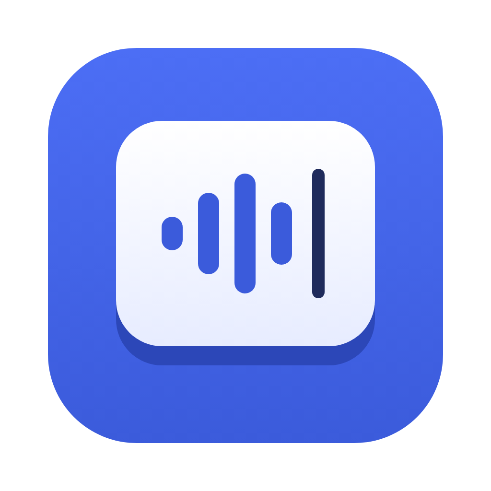
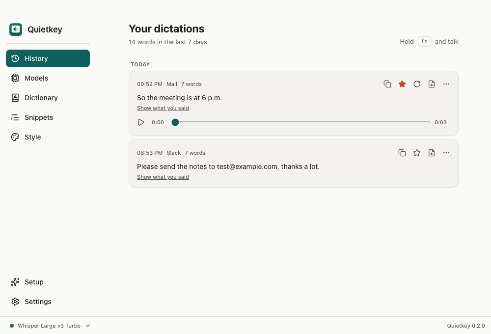
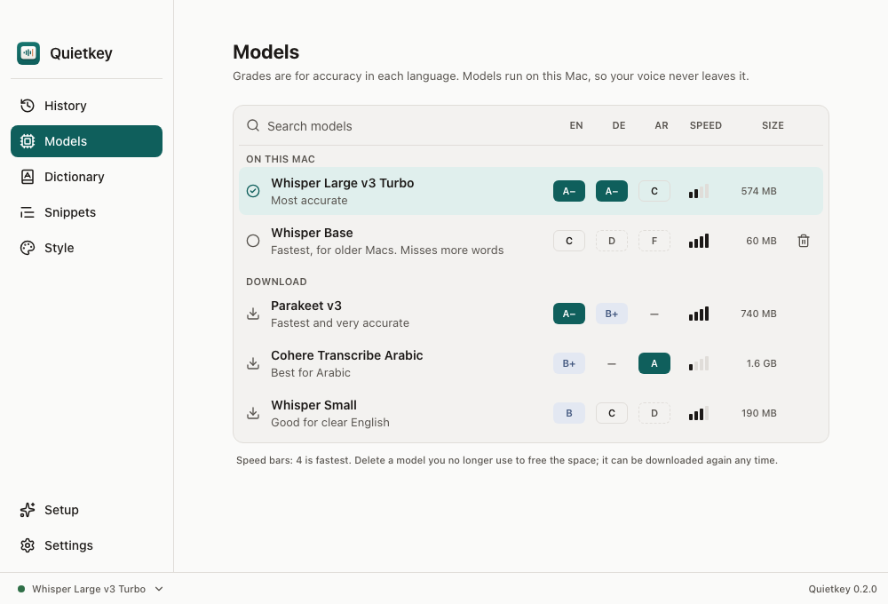

<p align="center">
  
</p>

<h1 align="center">Quietkey</h1>

<p align="center">
  Hold a key, talk, and your words are typed into any app on your Mac.<br>
  Free and open source. A private alternative to Wispr Flow, Superwhisper and MacWhisper.
</p>

<p align="center">
  <a href="https://github.com/abdallahaneed/quietkey/releases/latest/download/Quietkey.dmg"><b>⬇ Download Quietkey.dmg</b></a><br>
  <sub>Apple Silicon and Intel Macs, macOS 12 or later</sub>
</p>

<p align="center">
  
</p>

## Quick start

1. [Download Quietkey.dmg](https://github.com/abdallahaneed/quietkey/releases/latest/download/Quietkey.dmg) and drag Quietkey into Applications.
2. Open it once with a right-click on Quietkey → **Open** → **Open**. (The app is not notarized by Apple yet, so a normal double-click is blocked the first time. See [FAQ](#faq).)
3. Pick how speech becomes text:
   - **Groq, with your free key:** get a key at [console.groq.com/keys](https://console.groq.com/keys) (no card), paste it. Nothing to download.
   - **On this Mac:** Setup starts downloading Parakeet (740 MB) right away while you do the other steps. Works offline, your voice never leaves the Mac. Other models are on the Models page.
4. Allow the three permissions Setup asks for, then click any text field, **hold `fn`**, talk, let go.

That's it. No account, no subscription, no word limit.

## Why Quietkey

- **Free, for real.** No trial, no weekly word cap, no paid tier. MIT licence.
- **Private by default.** Run the speech model on your Mac and nothing is uploaded. Or use your own Groq key: audio goes to Groq and nowhere else. There is no Quietkey server.
- **Your first words are kept.** The microphone stays ready for 20 seconds after a dictation, so the next one starts the instant you press the key.
- **Names come out right.** Select a misheard word in your history and choose **Add to dictionary**. Quietkey spells it your way from then on.
- **Fast on any Mac.** Parakeet v3 is the default: a 40 second dictation is text in about 1.5 seconds, a short one in under 0.2 s. It covers English, German and 23 more European languages and uses about 230 MB of memory.
- **Pick the model for your languages.** The Models page grades every model from A to F for English, German and Arabic, with speed and size, and puts the best fit for your languages first. Search, download, delete, or switch models from the bar at the bottom of the window.
- **Whisper when you need it.** For 90 more languages, or dictionary words as spelling hints: Whisper Base (180 MB of memory), Small (350 MB) or Large v3 Turbo (700 MB).
- **Arabic.** Cohere Transcribe Arabic (1.6 GB download) is made for Arabic, dialects included: 8 seconds of speech is text in under a second. English words inside Arabic speech are written in Arabic letters.
- **History you can replay.** Each dictation keeps its recording: play it, transcribe it again with another model, star it, or save it to a text file.
- **Cleans up as you talk, offline.** Removes "um", repeated words and corrections like "at 5, actually 6". Say "new line" or "new paragraph".
- **Never pastes the wrong thing.** Your clipboard is put back after every paste, and `⌃⌘V` pastes your last dictation again.

<p align="center">
  
</p>

## Features

- Hold `fn` to talk. Double-press `fn` (or `fn` + `Space`) for hands-free, press again to stop. `Esc` cancels, with Undo.
- A short sound when recording starts and stops (switch it off in Settings → Sound).
- Choose another shortcut in Settings if you use `fn` for something else.
- Dictionary with "heard → write" corrections, import from a text or CSV file.
- Snippets: say "my email" and get the full address.
- Tone per kind of app: casual in chats, formal in email.
- Optional AI cleanup with your Groq key or a local [Ollama](https://ollama.com) model: fixes grammar, keeps your meaning.
- History you can keep, auto-delete after 24 hours (starred dictations stay), or switch off.
- Settings in grouped cards: every option has an ⓘ that explains it and a reset arrow back to the default.
- Silence and room noise are filtered out before transcription (Silero voice detection), so nothing is made up from background sound.
- The dictation bar sits above the Dock on the screen you are using, light and dark mode.

## Groq or on this Mac?

| | Groq (your free key) | On this Mac |
| --- | --- | --- |
| Setup | paste a key | one model download |
| Speed | very fast on any Mac | very fast with Parakeet, slower with Whisper and Cohere Arabic |
| Works offline | no | yes |
| Where your audio goes | Groq's servers | nowhere |
| Cost | free tier | free |

You can switch any time in Settings → Speech.

## Privacy

There is no Quietkey server and no analytics. Your history, dictionary, settings, speech models and the recordings behind your history are stored in `~/Library/Application Support/dev.abdallah.quietkey/` and your Groq key in the macOS Keychain. A recording is deleted together with its history entry, and none are kept when history is switched off. With a local model, nothing leaves your Mac. With Groq, each recording is sent to Groq to be transcribed. AI cleanup, if you turn it on, sends text only.

## FAQ

**macOS says Quietkey "can't be opened" or "is damaged".**
The app is not notarized yet (that needs a paid Apple Developer account). Right-click Quietkey in Applications → **Open** → **Open**. If macOS still refuses, run this once in Terminal:

```bash
xattr -cr /Applications/Quietkey.app
```

**Pressing `fn` opens the emoji picker or Apple's dictation.**
System Settings → Keyboard → **Press 🌐 key to** → **Do Nothing**. Or pick a different shortcut in Quietkey's Settings.

**Why does the microphone dot stay on after I stop?**
The mic stays open for 20 seconds so your next dictation starts instantly. Nothing is recorded in that time.

**Which permissions does it need, and why?**
Input Monitoring to notice your shortcut, Accessibility to type into other apps, and the Microphone. Quietkey never takes screenshots.

**How much disk space do the recordings take?**
About 2 MB per minute of speech, only the part where you talk. Delete history in Settings → Privacy, or set it to delete after 24 hours.

**Does it work in every app?**
Anywhere you can paste text: Mail, Slack, Notes, browsers, Terminal, VS Code, Word.

## Build from source

```bash
brew install cmake        # plus Rust and Node 20+
npm install
npm run tauri dev
```

Release: `scripts/release.sh` builds the signed universal `dist/Quietkey.dmg` (needs the Quietkey Signing certificate in your keychain; permissions then stay granted across updates).

Tests: `cd src-tauri && cargo test --lib`, `npx playwright test`, and `scripts/e2e/suite.sh` drives the real app end to end.

How it fits together: `hotkey.rs` listens for the key with a Core Graphics event tap, `audio.rs` records with cpal, `stt.rs` runs Parakeet, Whisper and Cohere Arabic through transcribe.cpp (Metal) after Silero voice detection, `llm.rs` talks to Groq or Ollama, `cleanup.rs` holds the offline rules, `paste.rs` pastes and restores the clipboard, `pipeline.rs` ties one dictation together and saves its recording. The UI is React with Tailwind; colours and sizes live in `src/styles/tokens.json`.

## Contributing

Issues and pull requests are welcome. If Quietkey saves you typing, a ⭐ helps other people find it.

## License

MIT
